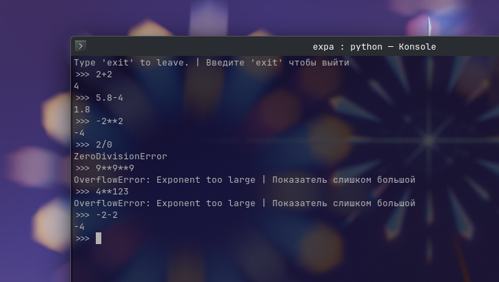

# expa.py

**Простой парсер выражений**

> eval, но безопасный

---

🇷🇺 For English documentation go to: [README.md](README.md)

---

## 📸 Как выглядит вживую:



## 🧑‍💻 Как исользовать:
### Клонируйте репозиторий:
```bash
git clone https://github.com/ilya-bushmelev/expa.py.git
```

---

Вы можете использовать парсер разными путями... (REPL оболочка, с помощью argv'ов, через import)

## Способы использовать:
### 1. Встроенная REPL оболочка
*(интерактивный режим)* 

Запустите expa.py в консоли (Windows - CMD, macOS - Terminal, Linux - tty, Konsole, GNOME Terminal, others) 
И вы увидете **приглашение** (`>>>`) 
Напишите, например, `2+2` и парсер выдаст результат `4`!

### 2. С помощью argv'ов
*(Note: если вы введёте любые argv'ы, то REPL оболочка не появится)*

В вашей консоли напишите команду, которая запускает expa.py. 
Далее напишите выражение, к примеру `2+2*2`.
Как результат к вышестоящему примеру `6` появится на экране консоли.

#### Пример использования:
```bash
$ python expa.py 2+2*2
> 6
```

### 3. Пайтон импорты
*(Убедитесь что expa.py в той же директории что и запускаемый пайтон скрипт)*

Выберите самый удобный для вас вариант:

#### 1. Импортировать весь скрипт

Самый лёгкий путь, но необходимо создать экземпляр класса для корректной работы, чтобы сделать это напишите: 

```python
import expa
# Убедитесь что вы создаёте экзеэмпляр ПОСЛЕ импорта, а иначе же NameError 
expa = expa.Expa()
```

#### 2. Импорт экземпляра
**Лучший и рекомендованный путь.** Импортирует встроенный экземпляр класса, нет надобности создавать новый. 

```python
from expa import expa
expa("2+2")
```

#### 3. Импорт класса

Если хотите создать свой экземпляр или подкласс (класс наследник). Вам надо создать экземпляр класса:

```python
from expa import Expa
expa = Expa()
# Для подкласса:
class MyExpa(Expa):
    def __init__(self):
        # Не забудьте про super().__init__()
        super().__init__()
    def my_method(self):
        ...
```

## Доступные операторы:
| Оператор | Назначение | Пример
| :---: | :--- | :--- |
| + | Прибавить | `2+2` |
| - | Вычесть | `5-2` |
| * | Умножить | `23*2` |
| / | Разделить | `234/2` |
| // | Целочисленное деление | `3//2` |
| ^, ** | Степень | `2**10` |