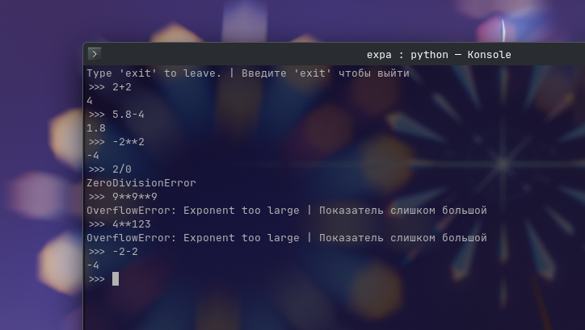

# expa.py

**Simple EXpression PArser**

> eval, but safe

---

🇷🇺 Для русской документации посмотрите: [README-ru.md](README-ru.md)

---

## 📸 Preview:



## 🧑‍💻 How to use:
### Clone this repository:
```bash
git clone https://github.com/ilya-bushmelev/expa.py.git
```

---

You can use it in different ways... (REPL-Shell, using argv's, through import)

## Ways to use:
### 1. Built in REPL-shell 
*(interactive mode)* 

Run expa.py directly in console (Windows - CMD, macOS - Terminal, Linux - tty, Konsole, GNOME Terminal, others) 
And you will see the **prompt** (`>>>`) 
Type, for example, `2+2` and you'll see the result `4`!

### 2. Using argv's
*(Note: if you type any argv's REPL-shell won't show up)*

In your console, type command that runs expa. 
After the command type your expression, for example `2+2*2`.
As a result, for expression above `6` will appear on the screen.

#### Example:
```bash
$ python expa.py 2+2*2
> 6
```

### 3. Python imports
*(Ensure expa.py is in the same directory as your python script you'll run)*

Choose which way is more comfortable for you:

#### 1. Import whole script

The easiest way, but you need to make a class instance for it to work properly, to do it type this: 

```python
import expa
# Make sure the instance goes AFTER import, otherwise you'll get a NameError
expa = expa.Expa()
```

#### 2. Import the instance directly.
**The best and recommended way.** Imports built in class instance, no need to create one. 

```python
from expa import expa
expa("2+2")
```

#### 3. Import the class directly.

If you want to make your own instance or a subclass. You have to create an instance to use:

```python
from expa import Expa
expa = Expa()
# For a subclass, do this:
class MyExpa(Expa):
    def __init__(self):
        # Make sure you don't forget about super().__init__()
        super().__init__()
    def my_method(self):
        ...
```

## Available operators:
| Operator | Purpose | Example
| :---: | :--- | :--- |
| + | Add | `2+2` |
| - | Subtract | `5-2` |
| * | Multiply | `23*2` |
| / | Divide | `234/2` |
| // | Integer divide | `3//2` |
| ^, ** | Exponentiation | `2**10` |